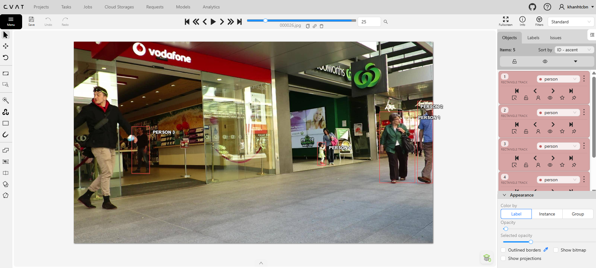
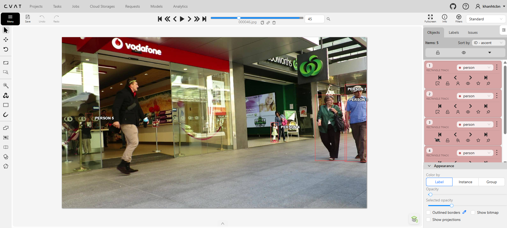
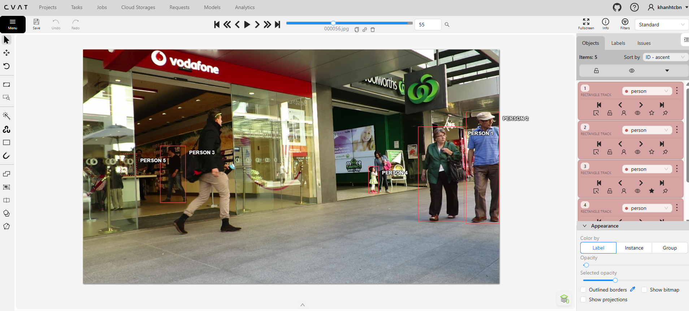

# Báo cáo cá nhân — NguyenBaoKhanh-2A202603191

Đoạn video: MOT17-09, 150 frame (frame 1–150), nguồn MOTChallenge, giấy phép CC BY-NC-SA 3.0.

## 0. Thông tin học viên

- Họ tên: Nguyễn Bảo Khánh
- MSSV: 2A202603191
- Mã đề (A/B/C): A
- Email: 26ai.khanhnb2@vinuni.edu.vn
- Link repository: https://github.com/NBK1612/K5-L2A-Day05-NguyenBaoKhanh-2A202603191-MOTTracking
- Giờ bắt đầu: 16:30
- Giờ kết thúc: 18:30

## 1. Xem trước đoạn video (CP0)

Ghi **trước khi vẽ**, mỗi người một dòng.

| Mã  | Frame xuất hiện | Frame cuối thấy được | Rẽ / dừng / đổi tốc độ ở frame | Bị che ở frame   | Ghi chú                                                                                   |
| --- | --------------- | -------------------- | ------------------------------ | ---------------- | ----------------------------------------------------------------------------------------- |
| P1  | 0               | 149                  | 14 rẽ                          | 32-51            | nam, áo đen, quần jean; đi trong khu cửa hàng Vodafone                                    |
| P2  | 39              | 149                  | 59 rẽ                          | 39-77 (một phần) | nữ, áo hồng/cam, quần đen; đi cạnh P1; frame 0-38 chưa vào cảnh                           |
| P3  | 0               | 149                  | không, đi thẳng đều            | không            | bà lớn tuổi, áo khoác xanh xám, túi đen; đi về phía camera, box to dần                    |
| P4  | 0               | 149                  | không, đi thẳng đều            | không            | ông lớn tuổi, áo polo sọc xanh, mũ trắng; đi cạnh P3; frame 0 chỉ ló ở mép phải           |
| P5  | 0               | 143                  | 27 dừng                        | 106-135; 144-149 | người nhỏ ở xa, đồ sáng màu; từ frame 144 bị P4 che hẳn đến hết đoạn, không ra khỏi khung |

Đối chiếu ID trên CVAT với mã người:

| ID trên CVAT | Track trong `annotations.xml` | ID trong `gt.txt` | Mã người |
| ------------ | ----------------------------: | ----------------: | -------- |
| PERSON 1     |                             0 |                 1 | P3       |
| PERSON 2     |                             1 |                 2 | P4       |
| PERSON 3     |                             2 |                 3 | P1       |
| PERSON 4     |                             3 |                 4 | P5       |
| PERSON 5     |                             4 |                 5 | P2       |

## 2. Keyframe và thời gian (CP1, CP4)

Số keyframe lấy từ kết quả `src/check_submission.py`.

| Mã       | Số keyframe | Keyframe ở frame                                                            | Số frame có mặt | Keyframe / 100 frame | Thời gian (phút) | Chỗ khó                                                       |
| -------- | ----------- | --------------------------------------------------------------------------- | --------------- | -------------------- | ---------------- | ------------------------------------------------------------- |
| P1       | 18          | 0, 10, 20, 26, 32, 50, 52, 55, 62, 72, 82, 92, 102, 112, 122, 132, 142, 149 | 140             | 12.9                 | 10               | bị che 32-55, mất hẳn 40-49                                   |
| P2       | 34          | 39-59 (mỗi frame), 68, 76, 78, 80, 81, 88, 98, 108, 118, 128, 138, 148, 149 | 111             | 30.6                 | 10               | vào cảnh khi đang bị che (39-77), box đổi kích thước liên tục |
| P3       | 16          | 0, 10, 20, …, 140, 149 (mỗi 10 frame)                                       | 150             | 10.7                 | 10               | đi về phía camera, box to dần                                 |
| P4       | 16          | 0, 10, 20, …, 140, 149 (mỗi 10 frame)                                       | 150             | 10.7                 | 10               | frame đầu chỉ ló ở mép phải; box to dần                       |
| P5       | 19          | 0, 10, 20, 30, 40, 50, 60, 70, 90, 100, 106, 135-141 (mỗi frame), 143       | 121             | 15.7                 | 10               | nhỏ, ở xa; bị che 106-135, bị P4 che hẳn từ 144               |
| **Tổng** | 103         |                                                                             | 672             | 15.3                 | 50               |                                                               |

Keyframe / 100 frame của cả bài = tổng keyframe ÷ tổng số frame có mặt x 100 = 103 ÷ 672 x 100 = 15.3

Bạn đặt keyframe nhiều nhất ở người nào? Vì sao (người đó rẽ, dừng, lại gần camera hay bị che)?

Nhiều nhất là P2 (34 keyframe, 30,6 / 100 frame). Gần như toàn bộ nằm ở frame 39-59, mỗi frame một keyframe: đây là lúc P2 mới bước vào cảnh từ mép trái và đang bị che một phần (38 frame `occluded`), phần nhìn thấy thay đổi liên tục nên nội suy tuyến tính không bám được. Sau frame 59 P2 rẽ rồi đi đều, keyframe thưa lại khoảng 10 frame một lần.

## 3. Đoạn bị che (CP2)

Người bị che: `P1` (PERSON 3 trên CVAT)

| Mốc                                      | Frame |
| ---------------------------------------- | ----: |
| Bắt đầu bị che một phần (bật `occluded`) |    32 |
| Mất hẳn (bật `outside`)                  |    40 |
| Hiện lại (tắt `outside`)                 |    50 |
| Thấy rõ trở lại (tắt `occluded`)         |    55 |

- Thời gian khuất hẳn: **10 frame = 0,33 giây** (frame 40-49).
- Quyết định: giữ cùng ID.
- Lý do (trả lời 3 câu: khuất bao lâu so với 60 frame, ngoại hình có khớp, chỗ hiện lại có đúng hướng và tốc độ):

1. Khuất hẳn 10 frame (0,33 giây), dưới ngưỡng 60 frame của lớp.
2. Ngoại hình: (áo đen, quần jean trước và sau đoạn che có khớp không?). Có khớp
3. Hướng và tốc độ: (chỗ P1 hiện lại ở frame 50 có nằm đúng hướng đi trước frame 40 không?). Có, P1 đi từ trái sang phải, hiện lại ở frame 50 vẫn đúng hướng và tốc độ.

Ảnh chụp màn hình:





## 4. Tự review ID (CP3)

Lượt 1 theo người (đi ngược từ frame 149 về 0 trên CVAT), lượt 2 theo cảnh (nhảy 10 frame). Ít nhất 3 dòng; không có lỗi thì ghi một dòng "đã kiểm hai lượt, không lỗi".

Loại lỗi dùng đúng một trong 7 mã: `id_switch`, `fragmentation`, `lost`, `merge`, `false_track`, `drift`, `flag`.

| Frame | Mã người | Loại lỗi | Mô tả một câu                           | Phát hiện ở lượt | Đã sửa? |
| ----: | -------- | -------- | --------------------------------------- | ---------------- | ------- |
|       | P1-P5    |          | Đã kiểm hai lượt, không lỗi Lượt 1 và 2 |                  |         |
|       |          |          |                                         |                  |         |
|       |          |          |                                         |                  |         |

Tổng hợp số lỗi theo loại:

| `id_switch` | `fragmentation` | `lost` | `merge` | `false_track` | `drift` | `flag` |
| ----------: | --------------: | -----: | ------: | ------------: | ------: | -----: |
|           0 |               0 |      0 |       0 |             0 |       0 |      0 |

Lỗi nào chỉ lượt 2 (theo cảnh) mới thấy, lượt 1 (theo người) không thấy? Vì sao?

...

## 5. File xuất và kết quả tự kiểm (CP4)

| Kiểm tra                                                  | Kết quả                                                                       |
| --------------------------------------------------------- | ----------------------------------------------------------------------------- |
| Tên file MOT 1.1                                          | `src/exports/NguyenBaoKhanh_mot.zip`                                          |
| Tên file CVAT for video 1.1                               | `src/exports/NguyenBaoKhanh_cvat_video.zip`                                   |
| Số track ID khác nhau trong `gt/gt.txt` (phải là 5)       | 5                                                                             |
| Frame `outside` không có dòng trong `gt.txt` (đúng / sai) | Đúng: P1 (ID 3) frame 40-49, P5 (ID 4) frame 112-134 và 144-149 không có dòng |
| Job đã completed trên CVAT máy cá nhân                    | completed                                                                     |

Dán phần tóm tắt in ra từ `src/check_submission.py`:

```text
=== File MOT 1.1: NguyenBaoKhanh_mot.zip ===
  Số track ID: 5   |   Tổng số box: 672
  [OK]        Đúng 5 track ID.

  Track | Frame có mặt | Số frame | Đoạn vắng (outside)
      1 |   0-149      |      150 | -
      2 |   0-149      |      150 | -
      3 |   0-149      |      140 | 40-49
      4 |   0-143      |      121 | 112-134
      5 |  39-149      |      111 | -

=== File CVAT for video 1.1: NguyenBaoKhanh_cvat_video.zip ===

  Track | Nhãn   | Frame thấy | Keyframe | KF/100 frame | Frame occluded | Lần bật outside
      0 | person |        150 |       16 |         10.7 |              0 |               0
      1 | person |        150 |       16 |         10.7 |              0 |               0
      2 | person |        140 |       18 |         12.9 |             13 |               1
      3 | person |        121 |       19 |         15.7 |              9 |               2
      4 | person |        111 |       34 |         30.6 |             38 |               0

  Tổng: 103 keyframe / 672 frame có mặt = 15.3 keyframe / 100 frame
  [OK]        Đọc được 5 track từ annotations.xml.

=== Tóm tắt ===
  Lỗi: 0   |   Cảnh báo: 0
  Đạt. Dán phần tóm tắt này vào báo cáo mục 5.
```

## 6. Ba câu kết

1. Nếu được gán lại, bạn sẽ đặt keyframe khác ở đâu? Vì sao?

   ...

2. Có chỗ nào bạn không chắc "cùng ID hay ID mới"? Bạn đã quyết định và ghi chú thế nào?

   ...

3. Một lỗi ID trong job của bạn (nếu không còn sót, chọn lỗi đã sửa) có thể làm xe tự lái dự đoán sai chuyển động của người đó như thế nào? Lỗi đó ảnh hưởng MOTA hay IDF1 nhiều hơn?

   ...

## Bonus (nếu làm)

### B1 — Hai người đi sát

...

### B2 — So cách đặt keyframe

| Cách đặt           | Số keyframe | Frame trôi nhất | Ghi chú |
| ------------------ | ----------: | --------------: | ------- |
| Đều mỗi 30 frame   |             |                 |         |
| Theo chỗ đổi hướng |             |                 |         |

...

### B3 — So với tracker có sẵn

| Frame | Mã người | Tracker làm gì | Nhãn của bạn | Giải thích (đoán rồi sửa / ghép IoU / box score thấp / ngoại hình) |
| ----: | -------- | -------------- | ------------ | ------------------------------------------------------------------ |
|       |          |                |              |                                                                    |
|       |          |                |              |                                                                    |

## 7. Tài liệu tham khảo và công cụ AI đã dùng

- Dữ liệu: MOT17, MOTChallenge (Milan et al., 2016), giấy phép CC BY-NC-SA 3.0.
- Tài liệu lớp: `docs/GUIDELINE.md`, `docs/CVAT_LOCAL_SETUP.md`, `docs/MOT_FORMAT.md`, `CHECKPOINTS.md`.
- Claude Code (trợ lý AI dạng chat), dùng để:
  - hướng dẫn cài môi trường Python, chạy script tạo task và cách thao tác trên CVAT (track mode, `occluded`, `outside`, xuất file);
  - giải thích quy ước nhãn, định dạng `gt.txt` và kết quả của `src/check_submission.py`;
  - đối chiếu điểm tham chiếu trong bảng nhận diện với box trong `gt.txt` để xác nhận PERSON 1-5 ứng với P1-P5;
  - chép số liệu từ kết quả script vào mục 2, 3, 5 và trình bày bảng.
- Việc gán box, đặt keyframe, đặt cờ và quyết định ID do tôi tự làm trên CVAT. Mục 4 và mục 6 do tôi tự viết.
